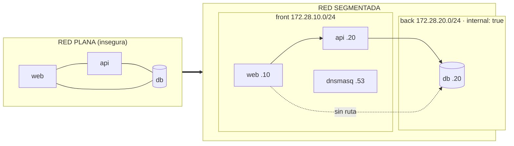

# Sesión 1 — Tu primer stack con Docker Compose (y por qué la red importa)

Laboratorio N.º 14 · Clase 1 · **Pista A (Docker Compose)** · ~120 min

## Objetivo de la sesión

Levantar tu **primer stack completo con un solo archivo** (`docker compose up`),
descubrir en carne propia **por qué una red plana es insegura** y refactorizarlo
en **subredes** (`front`/`back`) con **DNS interno**, comprobando cada paso con
comandos de red (no con la fe del YAML).

Al terminar sabrás **hacer** y **explicar**:

- [ ] Qué es la orquestación declarativa: un archivo describe, Compose reconcilia.
- [ ] Diferencia entre una red compartida y dos subredes aisladas (segmentación).
- [ ] Qué protege `internal: true` y qué **no**.
- [ ] Diferencia entre `ports:` (publicar al host / NAT) y `expose:` (solo interno).
- [ ] Cómo funciona el DNS en Docker (`127.0.0.11`) y un DNS propio (`dnsmasq`).
- [ ] Por qué la API es el **puente** y la DB nunca debe serlo.

> **Sesión independiente:** se puede hacer **sola**, sin sesiones previas y sin
> Packet Tracer. Parte de cero y termina con un stack segmentado funcionando.

> **Archivos listos:** si no quieres copiar los bloques a mano, la carpeta
> [`sesion-1/`](sesion-1/README.md) ya trae todo (`docker-compose.yml`,
> `docker-compose.segmentado.yml`, `dnsmasq.conf`, `api/` y `verificar.sh`). Los
> bloques de abajo son el mismo contenido, escritos paso a paso.

> **Pista opcional:** el laboratorio de [PACKET-TRACER.md](PACKET-TRACER.md) es
> **autónomo** y **no influye** en esta sesión ni en su nota.

## Mapa de la sesión (~120 min)

| Min | Bloque | Qué se hace |
|----:|--------|-------------|
| 0-10 | Encuadre | La red es el tema, Compose es el medio |
| 10-35 | **Paso 1** | Primer `docker compose up` (red plana) + explorar la red |
| 35-50 | **Paso 2** | Comprobar el problema: la web alcanza la DB |
| 50-90 | **Paso 3** | Segmentar (`front`/`back` + `internal` + DNS) y verificar |
| 90-105 | **Paso 4** | Puente conceptual: Docker ↔ red física |
| 105-120 | Cierre | Preguntas 1-4 y entrega |

---

## Conceptos de red de esta sesión

Esta sesión toca tres capas del modelo OSI. Antes de teclear, ubica cada
concepto (repaso ampliado en [TEORIA.md](TEORIA.md) §1):

| Concepto de red | Capa | Cómo se ve en Compose | Evidencia que vas a generar |
|-----------------|:----:|-----------------------|-----------------------------|
| **Segmentación** (dominios de difusión) | 2 | dos `networks`: `front` y `back` | `web` no ve a `db` |
| **Subredes / direccionamiento** | 3 | `ipam.config` + `ipv4_address` | `172.28.10.x` vs `172.28.20.x` |
| **Enrutamiento** (sin ruta = sin acceso) | 3 | `internal: true` corta el *egress* | `nc` a la DB: *timeout* |
| **DNS** (nombre → IP) | 7 (app) | `dnsmasq` en `172.28.10.53` | `nslookup web.local` |
| **Puertos y NAT** | 4 | `ports:` (host) vs `expose:` (interno) | `curl localhost:8080` |



## Antes de empezar (prerrequisitos)

```bash
# 1. Docker y Compose disponibles
docker --version
docker compose version

# 2. Que el puerto 8080 esté libre (lo usará la web)
(ss -ltn 2>/dev/null || netstat -ltn) | grep ':8080' && echo "OCUPADO" || echo "8080 libre"

# 3. Empezar limpio (si tenías otra sesión levantada, evita solapes de subred)
docker compose down -v --remove-orphans 2>/dev/null || true
```

> **Nota:** cada sesión usa las mismas subredes (`172.28.10.0/24` y
> `172.28.20.0/24`). Baja un stack (`down`) antes de levantar otro.

---

## Paso 1: Tu primer `docker compose up` (3 servicios, un archivo)

```bash
mkdir -p ~/lab14/sesion-1/api && cd ~/lab14/sesion-1

cat > api/app.py << 'PY'
import socket
from flask import Flask, jsonify

app = Flask(__name__)

# La API es el puente front<->back: por eso conoce la DB por su IP interna.
DB_HOST = "172.28.20.20"
DB_PORT = 5432


@app.route("/ping")
def ping():
    return "API viva"


@app.route("/db")
def db():
    """Comprueba en vivo que la API alcanza la base de datos (red back)."""
    try:
        with socket.create_connection((DB_HOST, DB_PORT), timeout=3):
            return jsonify(db="alcanzable", host=DB_HOST, port=DB_PORT)
    except OSError as exc:
        return jsonify(db="inalcanzable", host=DB_HOST, port=DB_PORT,
                       error=str(exc)), 503


@app.route("/info")
def info():
    """Muestra las interfaces de red de la API (sus dos redes)."""
    return jsonify(host=socket.gethostname(), db_host=DB_HOST)


if __name__ == "__main__":
    app.run(host="0.0.0.0", port=8000)
PY

cat > api/Dockerfile << 'DOCKER'
FROM python:3.11-slim
RUN pip install --no-cache-dir flask
WORKDIR /app
COPY app.py .
CMD ["python", "app.py"]
DOCKER

cat > docker-compose.yml << 'YAML'
services:
  web:
    image: nginx:alpine
    ports: ["8080:80"]

  api:
    build: ./api

  db:
    image: postgres:15-alpine
    environment:
      POSTGRES_PASSWORD: labpass123
YAML

docker compose up -d
docker compose ps
curl -s -o /dev/null -w "web responde %{http_code}\n" http://localhost:8080
```

Salida esperada (resumida):

```text
NAME              IMAGE               ...   PORTS
sesion-1-api-1    sesion-1-api        ...   8000/tcp
sesion-1-db-1     postgres:15-alpine  ...   5432/tcp
sesion-1-web-1    nginx:alpine        ...   0.0.0.0:8080->80/tcp
web responde 200
```

```text
[Checkpoint] Un archivo YAML levantó 3 servicios con un comando.
```

> **Esto es orquestación en su forma más simple:** tú declaras *qué* quieres
> (`docker-compose.yml`) y Compose crea, conecta y arranca *cómo* lograrlo. No
> escribiste ni un `docker run`.

### Paso 1b: Explora la red que Compose acaba de crear

El YAML no dijo nada de redes… y sin embargo Compose creó una. Obsérvalo:

```bash
# Compose crea una red por proyecto; aquí todo quedó en la MISMA red
docker network ls | grep sesion-1

# ¿Qué subred e IPs se asignaron solas?
docker network inspect sesion-1_default \
  --format '{{range .IPAM.Config}}subred={{.Subnet}} gateway={{.Gateway}}{{end}}'
docker inspect sesion-1-web-1 \
  --format '{{range $k,$v := .NetworkSettings.Networks}}{{$k}}={{$v.IPAddress}}{{end}}'
docker inspect sesion-1-db-1 \
  --format '{{range $k,$v := .NetworkSettings.Networks}}{{$k}}={{$v.IPAddress}}{{end}}'

# ¿Cómo resuelve nombres un contenedor? (DNS embebido de Docker)
docker compose exec web cat /etc/resolv.conf
```

Salida esperada (las IPs pueden variar, la subred por defecto suele ser
`172.18.0.0/16`):

```text
sesion-1_default=172.18.0.3
sesion-1_default=172.18.0.4
nameserver 127.0.0.11
```

```text
[Checkpoint] Compose creó una red y un DNS embebido (127.0.0.11) sin pedírtelo:
ese es el "cómo" de la orquestación.
```

> Fíjate en algo clave: **todos los servicios comparten la misma red**. Eso es
> una red plana. En el Paso 2 verás por qué es un problema.

---

## Paso 2: El problema — la red plana

Como todos están en la misma red, todos se ven entre sí. Compruébalo:

```bash
# La web resuelve el nombre de la BD…
docker compose exec web getent hosts db

# …y puede conectarse directamente a la base de datos. ESO ES PELIGROSO.
# (usamos -w 3 para no quedarnos colgados esperando)
docker compose exec web sh -c "nc -zv -w 3 db 5432" 2>&1 | tail -1

# La web también llega a la API…
docker compose exec web wget -qO- http://api:8000/ping
```

Salida esperada:

```text
172.18.0.4    db
db (172.18.0.4:5432) open
API viva
```

```text
[Checkpoint] web → db 5432: la conexión SE ABRE. La red plana no protege nada.
```

**El problema, en una frase:** no hay **segmentación**. Y como no hay
segmentación, tampoco hay forma de decir "solo la API tiene derecho a hablar con
la DB". Cualquier servicio comprometido alcanza a todos los demás.

> **Pregunta para pensar (la responderás en la 2):** la web *debería* poder
> hablar con la API (`web → api`), pero **no** con la base de datos
> (`web ↛ db`). Si las dos cosas son "conexiones entre contenedores", ¿cómo
> distinguimos una legítima de una peligrosa? Con **subredes distintas**.

---

## Paso 3: Segmenta — `front`/`back` + DNS

Ahora el mismo stack, pero con **dos redes** (como dos VLAN) y **IPs fijas**
(como un direccionamiento planificado), más un **DNS interno**.

```bash
cd ~/lab14/sesion-1

cat > dnsmasq.conf << 'CONF'
address=/web.local/172.28.10.10
address=/api.local/172.28.10.20
address=/db.local/172.28.20.20
CONF

cat > docker-compose.segmentado.yml << 'YAML'
services:
  dns:
    image: strm/dnsmasq
    container_name: dns-corp
    volumes: [ ./dnsmasq.conf:/etc/dnsmasq.conf:ro ]
    networks:
      front: { ipv4_address: 172.28.10.53 }
    command: ["-k", "--log-facility=-", "-u", "root"]   # -u root evita el fallo "setting capabilities"

  web:
    image: nginx:alpine
    container_name: web-srv
    ports: ["8080:80"]
    depends_on: [api]
    networks:
      front: { ipv4_address: 172.28.10.10 }

  api:
    build: ./api
    container_name: api-srv
    networks:
      front: { ipv4_address: 172.28.10.20 }
      back:  { ipv4_address: 172.28.20.10 }

  db:
    image: postgres:15-alpine
    container_name: db-srv
    environment:
      POSTGRES_PASSWORD: labpass123
    volumes: [pgdata:/var/lib/postgresql/data]
    networks:
      back: { ipv4_address: 172.28.20.20 }

networks:
  front:
    driver: bridge
    ipam:
      config:
        - subnet: 172.28.10.0/24
  back:
    driver: bridge
    internal: true
    ipam:
      config:
        - subnet: 172.28.20.0/24

volumes:
  pgdata: {}
YAML

docker compose up -d            # recrea sobre el mismo proyecto
docker compose ps
```

¿Qué cambió respecto a la red plana?

| Antes (plano) | Ahora (segmentado) | Efecto de red |
|---------------|--------------------|---------------|
| 1 red implícita | 2 redes `front`/`back` | dos dominios separados |
| IPs automáticas | `ipv4_address` fijas | direccionamiento planificado |
| `back` con salida | `back` con `internal: true` | sin NAT hacia Internet |
| Solo DNS de Docker | + `dnsmasq` en `.53` | nombres propios del dominio |

### Verifica que ahora SÍ hay segmentación

```bash
# 1. web → db POR NOMBRE: ya no resuelve (la DB vive solo en 'back')
docker compose exec web getent hosts db            # sin salida

# 2. web → db por IP: prueba de RUTEO (no de DNS). Debe dar timeout.
docker compose exec web sh -c "nc -z -w 3 172.28.20.20 5432" 2>&1 | tail -1

# 3. api -> db: el único puente, sí conecta
docker compose exec api python -c \
  "import socket as s; s.create_connection(('172.28.20.20',5432),3); print('API alcanza la DB')"

# 4. DNS interno resuelve los 3 nombres
docker compose exec web nslookup web.local 172.28.10.53
docker compose exec web nslookup api.local 172.28.10.53
docker compose exec web nslookup db.local  172.28.10.53
```

Salida esperada:

```text
# 3
API alcanza la DB
# 4
Name:      web.local
Address 1: 172.28.10.10
Name:      api.local
Address 1: 172.28.10.20
Name:      db.local
Address 1: 172.28.20.20
```

```text
[Checkpoint] web ↛ db · api → db OK · DNS resuelve los 3 nombres.
```

> **Truco de la API (extra):** la API expone `/db`. Aunque `web` **no** puede
> tocar la DB, sí puede pedirle a la API que lo compruebe *por ella*:
>
> ```bash
> docker compose exec web wget -qO- http://api:8000/db
> # {"db":"alcanzable","host":"172.28.20.20","port":5432}
> ```
> Ese es exactamente el patrón de un **servicio mediado**: el frontend nunca
> habla con la base de datos; habla con la API.

> **`internal: true`** quita la salida a Internet de la red interna.
> **Que la DB no publique `ports:`** la vuelve inalcanzable desde el host.
> Juntas, aíslan los datos.

### Paso 3b: Verificación automática (recomendada)

La carpeta [`sesion-1/`](sesion-1/README.md) trae un script que corre **todas**
las pruebas anteriores y te dice OK/FALLO:

```bash
chmod +x verificar.sh
./verificar.sh
```

```text
Resultado: 7 OK, 0 FALLO
```

```text
[Checkpoint] Una sola orden valida segmentación, aislamiento, DNS y puerta web.
```

### Paso 3c: Rompe y arregla (aprende el *porqué*)

Haz un cambio, predice qué pasará, ejecútalo y explica el resultado:

1. **Publica la DB.** Añade a `db` un `ports: ["5432:5432"]` y `up -d`. Ojo:
   **no basta** — la DB vive en `back`, que es `internal: true`, y eso también
   corta el NAT hacia el host, así que el puerto se ignora en silencio
   (`docker inspect db-srv --format '{{json .NetworkSettings.Ports}}'` →
   `{"5432/tcp":null}`). Quita también `internal: true` de `back` y entonces sí:
   desde el host, `nc -zv localhost 5432` conecta → la segmentación se rompió
   **desde el host** aunque las redes sigan separadas. (*Por eso `ports:` importa:
   publicar son **dos** condiciones — `ports:` en el YAML y que el contenedor
   tenga camino de salida al host.*) Deshaz los dos cambios al terminar.
2. **Quita `internal: true`** de `back` y `up -d`. La web sigue sin tener ruta a
   `back` (el aislamiento *entre* redes lo da la pertenencia, no `internal`), pero
   los contenedores de `back` ahora **sí salen a Internet** (NAT). Concluye:
   `internal` controla el *egress*, no el acceso entre contenedores.
3. **Pon `web` en `back`** además de `front`. Ahora `web` vuelve a alcanzar la DB
   por IP: tu aislamiento dependía de **dónde conectaste cada servicio**.

```text
[Checkpoint] Entiendes que la seguridad de la red la definen DOS cosas:
qué servicios comparten red y qué puertos se publican.
```

---

## Paso 4: Puente conceptual (de la red virtual a la red física)

Fija la correspondencia entre lo que acabas de **ejecutar** y su equivalente en
una red física tradicional:

| Ahora viviste en Docker | Su gemelo conceptual (red física) |
|-------------------------|-----------------------------------|
| `docker-compose.yml` | el diagrama lógico de la red |
| red `front` (172.28.10.0/24) | VLAN / perímetro público |
| red `back` `internal: true` | red interna sin ruta a Internet |
| DB sin `ports:` | servidor interno sin gateway |
| API multi-red (el puente) | bastión dual-homed |
| `depends_on: [api]` | el orden de arranque esperado |
| `dnsmasq` en `.53` | servidor DNS de la LAN |
| `ports: ["8080:80"]` | NAT / publicación de un servicio |

### Paso 4b: DNS a fondo (dos mecanismos conviviendo)

En el stack conviven **dos** resoluciones de nombres. Apréndete a distinguirlas:

| Mecanismo | Dirección | Resuelve | Cuándo usar |
|-----------|-----------|----------|-------------|
| DNS embebido de Docker | `127.0.0.11` | nombres de servicio/compose (`web`, `api`, `db`) | comunicación entre servicios |
| `dnsmasq` propio | `172.28.10.53` | nombres "de empresa" (`web.local`, `api.local`, `db.local`) | nombres internos estables |

```bash
# El resolv.conf apunta al DNS embebido…
docker compose exec web cat /etc/resolv.conf | head -1

# …pero le pedimos explícitamente al dnsmasq propio
docker compose exec web nslookup db.local 172.28.10.53

# Comparación: nombre de servicio (embebido) vs nombre corporativo (dnsmasq)
docker compose exec web getent hosts api     # 172.28.10.20  api
docker compose exec web nslookup api.local 172.28.10.53
```

> **Pista opcional:** en [PACKET-TRACER.md](PACKET-TRACER.md) (autónomo) puedes
> reproducir esta misma tabla con router, subredes, bastión y ACL. **No es
> requisito** para entregar esta sesión.

---

## Retos opcionales (sin nota, para quien quiera más)

1. **Tercera red `dmz`:** añade una red `dmz` (172.28.30.0/24) y un servicio
   `proxy`. ¿Quién debe tener interfaz en las tres redes y por qué?
2. **Túnel SSH para ver la DB sin publicarla:** desde el host,
   `ssh -L 5432:172.28.20.20:5432 usuario@localhost` y conecta tu cliente a
   `localhost:5432`. Demuestras que se puede dar acceso *controlado* sin romper
   la segmentación.
3. **Documenta el fallo:** captura el `Operation timed out` de web→DB por IP y
   explica en 3 líneas por qué **no** es un "connection refused".

---

## Errores frecuentes

| Síntoma | Causa | Solución |
|---------|-------|----------|
| `web` sí alcanza la DB | `web` y `db` comparten red (o la DB publica `ports:`) | sacar a `web` de `back`; revisar que la DB no publique puertos |
| Los nombres DNS no resuelven | IP del servicio ≠ IP en `dnsmasq.conf` | sincronizar `ipv4_address` |
| `port is already allocated` | otro stack usa el 8080 | `docker compose down` del otro |
| `network ... already exists` / solape de subred | otra sesión sigue levantada | `docker compose down -v` |
| `nc: bad address` o se cuelga | `nc` de busybox sin `-w` | usar `nc -z -w 3 <ip> <puerto>` |
| `Connection refused` en vez de *timeout* | hay ruta pero nadie escucha | revisa que pruebes la IP correcta |

---

## Preguntas de la sesión

1. Acabas de levantar 3 servicios **sin escribir `docker run`**. ¿Qué hace Compose
   que no hacía un `docker run` suelto?
2. En el Paso 2, `web` alcanzaba `db`. ¿Qué cambió exactamente en el Paso 3 para
   que ya no la alcance? Nombra las **dos** cosas.
3. ¿Qué protege `internal: true` y qué **no**? (Lo comprobarás en la Sesión 2).
4. Explica por qué **publicar `ports:` en la DB** rompería la segmentación.
   ¿Qué expondría y desde dónde sería alcanzable?

### Preguntas de refuerzo (opcionales)

5. ¿Por qué desde `web` la prueba por **nombre** falla distinto que la prueba por
   **IP**? ¿Qué demuestra cada una?
6. ¿Qué diferencia hay entre `expose: ["8000"]` y `ports: ["8000:8000"]`?

## Entregable de la sesión

- [ ] `docker-compose.segmentado.yml` con `front`/`back` (`back` con
      `internal: true`) + DNS.
- [ ] Pruebas de segmentación: `web ↛ db` (por nombre **y** por IP) y `api → db` OK.
- [ ] `nslookup` de `web.local`, `api.local` y `db.local`.
- [ ] Salida de `./verificar.sh` (**7 OK, 0 FALLO**).
- [ ] Respuestas a las preguntas 1-4.

## Resumen de la sesión

```text
Declarar (Paso 1)  →  ver el riesgo (Paso 2)  →  segmentar y verificar (Paso 3)
                   →  conectar con la red real (Paso 4)
```

Te llevas tres ideas para el resto del laboratorio:

1. **Compose describe, tú no orquestas a mano.** Un archivo = todo el stack.
2. **La red es una decisión de diseño, no un accidente.** Dos redes y dos
   decisiones (`internal`, `ports`) son tu perímetro.
3. **Verifica siempre.** Un YAML bonito no prueba nada; `getent`, `nc` y
   `nslookup` sí.
