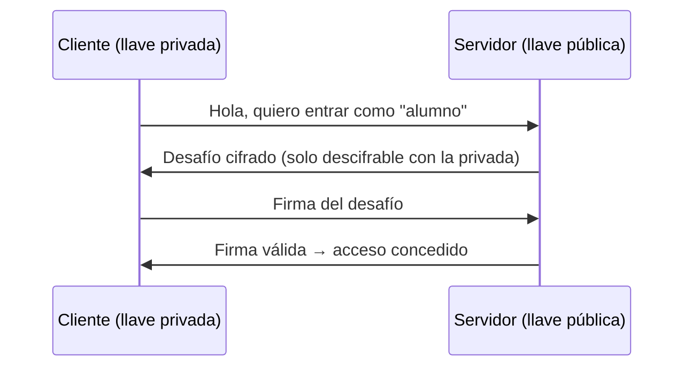

# Teoría — De la red real a la red virtual

Documento de apoyo del **Laboratorio N.º 14**. Consolida los conceptos de los
Labs 10, 11 y 12 en un solo hilo: qué es una LAN segmentada, cómo se monitorea,
cómo se protege el acceso y cómo se orquesta un despliegue. Sirve como lectura
previa y como material de repaso para la evaluación.

> **Hilo conductor:** cada concepto de red se estudia y se *ejecuta* en Docker
> Compose (la red del data center). La sección 6 incluye una tabla que, **de
> forma opcional**, compara cada concepto con su equivalente en Packet Tracer
> (pista B); dicha pista no es requisito.

---

## 1. LAN y segmentación

Una **LAN** (Local Area Network) es un conjunto de dispositivos conectados por un
medio común y administrados dentro de un mismo dominio de difusión. Una LAN
"plana" (todos en la misma red) se degrada porque:

- **Una sola tormenta de broadcast** afecta a todos.
- **No hay aislamiento de fallas**: un host comprometido alcanza a todos.
- **No hay priorización** de tráfico crítico.

La solución es **segmentar**. En el mundo físico se hace con **VLAN** (802.1Q):
el switch "etiqueta" los puertos y separa dominios de difusión aunque compartan
hardware. En el mundo Docker se hace con **redes bridge**: cada `network` es un
dominio aislado.

| Concepto físico | Concepto Docker |
|-----------------|-----------------|
| VLAN 802.1Q | `docker network` (bridge) |
| Puerto de switch (access) | Interfaz del contenedor en la red |
| Puerto trunk | Contenedor multi-red (dos `networks:`) |
| Rango de subred por VLAN | `ipam.config.subnet` |

### Subredes (capa 3)

Segmentar en VLAN no basta si todas siguen en el mismo rango lógico: hace falta
**direccionamiento**. Aquí se usa **VLSM** (Variable Length Subnet Mask) para
ajustar cada subred al número real de hosts (ver el laboratorio de VLSM y el
Caso 3 del ECOSISTEMA). Reglas rápidas:

- `/24` = 254 hosts · `/26` = 62 · `/28` = 14 · `/30` = 2 (enlaces punto a punto).
- Reserva siempre **gateway, red y broadcast**.
- Sin **solapamiento** entre subredes.

### DHCP, DNS y NAT (repaso)

- **DHCP** (DORA: Discover, Offer, Request, Ack): entrega IP, máscara, gateway y
  DNS automáticamente. En Docker, el "DHCP" es el `ipam` y el DNS embebido
  (`127.0.0.11`).
- **DNS**: traduce nombres a IP. En Packet Tracer es el servidor DNS del
  escenario; en Docker es el DNS embebido o `dnsmasq` (`address=/web.local/...`).
- **NAT**: traduce IP privadas a públicas para salir a Internet. En Docker, el
  host hace NAT (masquerade) de las redes bridge; `internal: true` **desactiva**
  ese NAT para una red.

### El router de capa 3

Une subredes. Decide por su **tabla de enrutamiento** y solo si hay **ruta de
ida y de vuelta**. En Docker no hay router explícito: el kernel del host enruta
entre bridges, y un contenedor multi-red actúa como "puente" de aplicación.
**La diferencia pedagógica clave:** en Packet Tracer el routing es *visible*
(tabla, ACL, Simulation mode); en Docker es *implícito*.

---

## 2. Monitoreo

Administrar sin medir es adivinar. Las métricas base de la red:

| Métrica | Qué mide | Herramienta Docker |
|---------|----------|--------------------|
| Ancho de banda | bits/s usados | `iftop`, netdata |
| Latencia | retardo extremo a extremo | `ping`, `mtr` |
| Pérdida de paquetes | % no entregados | `ping`, `iperf3 -u` |
| Jitter | variación del retardo | `iperf3 -u` |
| Throughput | datos útiles por segundo | `iperf3`, `netdata` |

**TCP vs UDP con `iperf3`:** TCP ajusta su ventana y reintenta (throughput más
bajo, sin pérdidas); UDP transmite sin control (throughput alto, con pérdidas y
jitter si saturas).

### Herramientas del laboratorio

- **`tcpdump`**: captura paquetes. `-i eth0 -n port 80`. El equivalente a la
  **Simulation mode** de Packet Tracer.
- **`iftop`**: tráfico por conexión en tiempo real.
- **`iperf3`**: prueba de rendimiento cliente/servidor (`-s` servidor, `-c`
  cliente, `-u` UDP, `-R` inverso).
- **`netdata`**: panel web con CPU, red, disco por contenedor.

### Monitoreo por capas OSI

- Capa 1-2: errores, colisiones, MAC (`iftop`, statistics de PT).
- Capa 3: rutas, ICMP, latencia (`ping`, `traceroute`).
- Capa 4: puertos, handshakes TCP (`tcpdump`, `netstat`).
- Capa 7: peticiones HTTP, códigos (`curl`, logs de nginx).

---

## 3. Claves SSH y acceso

**SSH** da una terminal cifrada y autenticada. Dos formas de autenticar:

| Método | Cómo | Seguridad |
|--------|------|-----------|
| Contraseña | se envía el secreto | suceptible a fuerza bruta |
| **Llave pública/privada** | el cliente firma un desafío con su privada | resistente a fuerza bruta |

- **Llave privada** (`id_ed25519`): secreta, `chmod 600`, nunca se comparte.
- **Llave pública** (`.pub`): va en `~/.ssh/authorized_keys` del servidor.

`ed25519` es más corta y rápida que RSA y se recomienda por defecto.

### Túneles SSH

- **`-L` (local)**: reenvío un puerto local a un destino remoto. Sirve para
  alcanzar una DB interna sin publicarla:
  `ssh -L 5432:db.local:5432 usuario@host`.
- **`-J` (ProxyJump)**: salta a través de un bastión:
  `ssh -J bastion usuario@interno`.

---

## 4. Servidor bastión

Un **bastión** es el **único punto de entrada** a una red privada. Está
endurecido para que comprometerlo sea muy difícil, y el resto de servidores
internos no se exponen a Internet.

| Tipo | Interfaces | Uso |
|------|-----------|-----|
| Single-homed | 1 | Acceso a una sola red |
| Dual-homed | 2 | Puente controlado entre red pública e interna |
| Multihomed | 3+ | Gateway con varios caminos (web, proxy, VPN) |

### Por qué el bastión **no** debe ser un contenedor

1. **Kernel compartido:** todos los contenedores del host usan el mismo kernel;
   romper uno compromete a los demás. Un bastión real corre en su propio host/VM.
2. **Interfaces virtuales:** las "dos interfaces" son dos bridges; no hay un
   dispositivo físico de perímetro.
3. **Firewall invisible:** quien gobierna el tráfico es iptables del host, fuera
   de la vista del estudiante.

> **Regla del laboratorio:** en **Packet Tracer** el bastión es real (host con 2
> interfaces, SSH y ACL: allí se *diseña*). En **Docker** el bastión real es el
> **host**: única entrada SSH por llave y redes internas sin salida (allí se
> *ejecuta*).

---

## 5. Orquestación: Compose y (teoría) Swarm

### ¿Qué es orquestar?

Ejecutar *un* contenedor es fácil. La complejidad aparece con varios servicios,
réplicas, dependencias, actualizaciones y secretos. La orquestación **declara el
estado deseado** y el motor lo **reconcilia** (crea, escala, reinicia lo que
falla, respeta el orden de arranque).

### Docker Compose

- **Un solo host**, ideal para desarrollo y pruebas.
- Declarativo: un `docker-compose.yml` describe todo el stack.
- **Réplicas** con `--scale servicio=N`.
- **Balanceo** por DNS embebido (round-robin de nombres), no por proxy.
- **Dependencias** con `depends_on` + `condition: service_healthy`.
- **Secretos** con `secrets:` (montados en `/run/secrets`, fuera del YAML).
- **Salud** con `healthcheck` (Compose reinicia lo que no responde).

### Docker Swarm (solo teoría en este laboratorio)

- **Múltiples nodos** (cluster manager/worker).
- Red **overlay** entre nodos.
- **Balanceo ingress mesh**: un puerto publicado reparte entre réplicas.
- **Rolling update / rollback** y secretos gestionados por el clúster.
- `docker stack deploy` reutiliza el **mismo** YAML de Compose.

| | Docker Compose | Docker Swarm |
|--|----------------|---------------|
| Alcance | 1 host | Multi-nodo |
| Réplicas | `--scale` | `docker service scale` |
| Redes | bridge por proyecto | **overlay** entre nodos |
| Alta disponibilidad | No | Sí (manager/worker) |
| Balanceo | por DNS | ingress mesh |
| Uso típico | Desarrollo local | Producción simple / on-prem |

> **Transición:** lo aprendido con Compose migra 1:1 a Swarm y a Kubernetes
> (mismos conceptos: servicio, réplica, red, secreto, healthcheck).

---

## 6. Tabla maestra de correspondencias (PT ↔ Docker ↔ Teoría)

| Concepto | Packet Tracer | Docker Compose | Teoría |
|----------|---------------|----------------|--------|
| Segmentación | VLAN 10 / VLAN 20 | `networks: front / back` | dominio de difusión |
| Red interna sin salida | ruta que no existe | `internal: true` | aislamiento |
| Bastión | server dual-homed con SSH | el **host** (SSH por llave) | punto de entrada único |
| Firewall | ACL en el router | iptables / sin `ports:` | filtrado de paquetes |
| DHCP | pool del router | `ipam.config` | DORA |
| DNS | server DNS del escenario | `dnsmasq` / `127.0.0.11` | resolución de nombres |
| Router | R1 + tabla de rutas | kernel del host / contenedor multi-red | capa 3 |
| Monitoreo | Simulation mode | `tcpdump`, `iftop`, netdata | métricas de red |
| Balanceo | — (PT no lo hace) | DNS embebido (`--scale`) | alta disponibilidad |
| Orquestación | — | `docker compose up` | estado deseado |

---

## 7. Referencias

- Comer, D. (2018). *The Internet Book*. CRC Press.
- Forouzan, B. (2020). *Transmisión de datos y redes de comunicación*. McGraw-Hill.
- Kurose, J. & Ross, K. (2016). *Computer Networking: A Top-Down Approach*. Pearson.
- Tanenbaum, A. (2012). *Redes de computadoras*. Pearson.
- Docker Docs: *Networking*, *Compose file reference*, *Swarm mode*.
