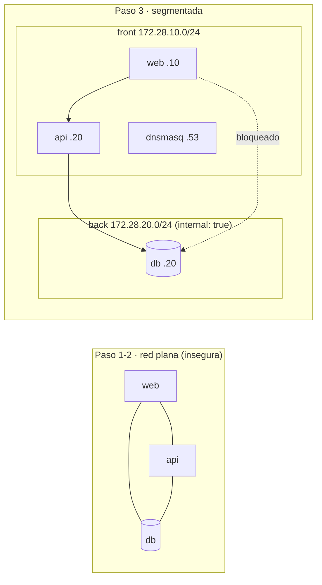

# Sesión 1 — archivos Docker (primer stack + segmentación)

Material de la **Sesión 1** del Laboratorio N.º 14. Aquí está todo lo necesario
para levantar el stack, ver el problema de la **red plana** y refactorizarlo a
**subredes** (`front`/`back`) con **DNS interno**. Guía completa:
[../SESION-1.md](../SESION-1.md).

> **Sesión independiente:** no necesitas las otras sesiones ni Packet Tracer.

## Topología



## Contenido

| Archivo | Para qué |
|---------|----------|
| `docker-compose.yml` | **Paso 1:** el primer stack en **red plana** (web/api/db). |
| `docker-compose.segmentado.yml` | **Paso 3:** el mismo stack con `front`/`back`, `internal: true` y DNS. |
| `dnsmasq.conf` | Zonas DNS internas (`web.local`, `api.local`, `db.local`). |
| `api/` | Código (`app.py`) y `Dockerfile` de la API (Flask). Expone `/ping` y `/db`. |
| `verificar.sh` | **Verificación automática** de segmentación, aislamiento y DNS. |

## Requisitos

```bash
docker --version && docker compose version   # Docker Engine + plugin compose
ss -ltn | grep -q ':8080' && echo "¡8080 ocupado!" || echo "puerto 8080 libre"
```

## Guía rápida

### Paso 1 — Red plana (el problema)

```bash
docker compose up -d
docker compose ps
curl -s -o /dev/null -w "web responde %{http_code}\n" http://localhost:8080

# La web resuelve y ALCANZA la base de datos: eso es lo peligroso.
docker compose exec web sh -c "nc -zv -w 3 db 5432"
# -> db (172.18.0.4:5432) open
```

### Paso 3 — Segmentar (front/back + DNS)

```bash
docker compose down --remove-orphans
docker compose -f docker-compose.segmentado.yml up -d
docker compose -f docker-compose.segmentado.yml ps
```

Verificación manual:

```bash
COMPOSE="docker compose -f docker-compose.segmentado.yml"

# 1) web NO alcanza la DB por nombre ni por IP
$COMPOSE exec web getent hosts db                                  # sin salida
$COMPOSE exec web sh -c "nc -z -w 3 172.28.20.20 5432"            # timeout

# 2) api SÍ alcanza la DB (el puente)
$COMPOSE exec api python -c \
  "import socket as s; s.create_connection(('172.28.20.20',5432),3); print('API -> DB OK')"

# 3) DNS interno
$COMPOSE exec web nslookup web.local 172.28.10.53
$COMPOSE exec web nslookup api.local 172.28.10.53
$COMPOSE exec web nslookup db.local  172.28.10.53
```

## Verificación automática (recomendada)

```bash
docker compose -f docker-compose.segmentado.yml up -d
chmod +x verificar.sh
./verificar.sh
```

Debe terminar con **`Resultado: 7 OK, 0 FALLO`**: web no resuelve/no alcanza la
DB, api sí la alcanza, los 3 nombres DNS resuelven y la web responde HTTP 200.

## Salidas esperadas (referencia)

| Prueba | Resultado correcto |
|--------|--------------------|
| `web` → `db` por nombre | `getent` sin salida (no resuelve) |
| `web` → `172.28.20.20:5432` | `Operation timed out` (sin ruta) |
| `api` → `172.28.20.20:5432` | conecta |
| `nslookup web.local` | `Address: 172.28.10.10` |
| `nslookup api.local` | `Address: 172.28.10.20` |
| `nslookup db.local` | `Address: 172.28.20.20` |
| `curl localhost:8080` | `HTTP 200` |

## Errores frecuentes

| Síntoma | Causa | Solución |
|---------|-------|----------|
| `web` SÍ alcanza la DB | falta `internal: true` en `back` o la DB publica `ports:` | corregir el YAML y `up -d` |
| Los nombres DNS no resuelven | IP del servicio ≠ `dnsmasq.conf` | sincronizar IPs (`ipv4_address`) |
| `port is already allocated` (8080) | otro stack arriba | `docker compose down` del otro |
| `network ... already exists` / solapes | quedó otra sesión levantada | `docker compose down -v` antes de subir |
| `nc: bad address` | `nc` sin `-w` (busybox) | usar `nc -z -w 3 <ip> <puerto>` |

## Limpieza

```bash
docker compose -f docker-compose.segmentado.yml down -v --remove-orphans
```

## Entregable

- [ ] `docker-compose.yml` con `front`/`back` (`back` con `internal: true`) + DNS.
- [ ] Pruebas: `web ↛ db` (por nombre y por IP) y `api → db` OK.
- [ ] `nslookup` de `web.local`, `api.local` y `db.local`.
- [ ] Salida del `./verificar.sh` (7 OK, 0 FALLO).
- [ ] Respuestas a las preguntas 1-4 de [../SESION-1.md](../SESION-1.md).
